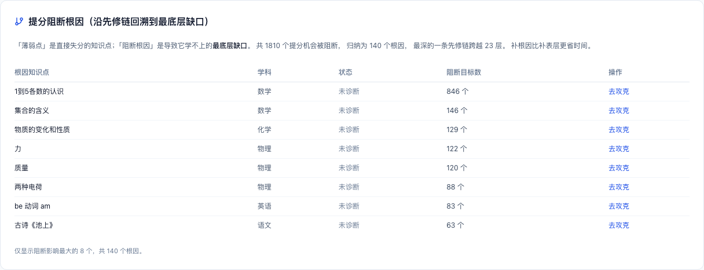

# cn-math-taxonomy 知识资产导入指南

把 `resources/cn-math-taxonomy` 的知识点 DAG 与题库转换成 daydayup 的
`CurriculumAsset` / `QuestionBankAsset` 格式。

> ⚠️ **授权**：cn-math-taxonomy 采用 **CC BY-NC 4.0**（署名-非商业性）。
> 商业使用（付费课程、付费 App、机构收费服务）**须先取得作者商业授权**。
> 详见 [`LICENSING.md`](../packages/server/src/infrastructure/knowledge/converters/LICENSING.md)。

---

## 快速开始

```bash
# 1. 看看会转换出什么（不写文件）
npm run import:taxonomy --workspace=@daydayup/server -- --dry-run

# 2. 导入到暂存目录（DRAFT，不生效）
npm run import:taxonomy --workspace=@daydayup/server

# 3. 教师审核通过后，发布为 ACTIVE
npm run import:taxonomy --workspace=@daydayup/server -- --promote
```

---

## 导入工作流（四步）

### 第 1 步：转换（产物 DRAFT，写入暂存目录）

```bash
npm run import:taxonomy --workspace=@daydayup/server
```

输出到 `packages/server/data/staging/`：

```
staging/
├── knowledge/shanghai-junior-taxonomy-2026.02.json   # 2760 个知识点，DRAFT
└── questions/bank-2026.02.json                        # 11187 道题
```

**DRAFT 不会在正式运行时被选中** —— 加载器优先选 `ACTIVE` 版本。

### 第 2 步：教师审核

审核对象是**先修边**（`prerequisites`）。cn-mt 自己的免责声明：

> 「先修关系（哪些是 hard、哪些是 soft，甚至某条边该不该存在）都需要一线教师审核」

同时需要补全 `commonTraps`（常见陷阱）—— cn-mt 不含错因数据，转换器留空并告警。

### 第 3 步：发布（`--promote`）

```bash
npm run import:taxonomy --workspace=@daydayup/server -- --promote
```

- 产物 `status` 置为 `ACTIVE`
- 写入正式目录 `data/knowledge/`、`data/questions/`
- 旧版本归档到 `data/staging/archived/`（题库同理，旧 `bank.json` 一并归档）

### 第 4 步：迁移存量学生数据（**换版必做**）

```bash
# 预演：只看会改什么，不写盘
npx tsx scripts/migrate-curriculum.ts --workspace=@daydayup/server

# 确认后写盘（自动备份到 data/backup/curriculum-migration-<时间戳>/）
npm run migrate:curriculum --workspace=@daydayup/server -- --apply --include-seed
```

**为什么不能跳过**：旧 id（`math-alg-rational`）在新资产里不存在，
而学生数据、计划、错题、辅导历史全都按 id 引用知识点。不迁移的后果**不抛异常**：

| 数据 | 不迁移的表现 |
|---|---|
| 掌握度记录 | 报告页静默丢弃，掌握轨迹变空 |
| 错题 / 变式题 | 点不进对应知识点，练不到题 |
| 7 天计划 | 任务悬空，排期空转 |
| 辅导历史 | 按新 id 读不到旧会话（文件还按旧 id 命名） |

迁移脚本做三件事：

1. **改写 id** —— 按 `LEGACY_ID_MAP` 把旧 id 换成新 id（键和值都改）
2. **改写展示文案** —— 计划/错题里烘焙的旧名称（`knowledgeName`、`title`）
   一并替换，否则会出现「化学符号、化合价与方程式配平」配 `cnk_j018 化学方程式的书写`
   这种自相矛盾的展示
3. **重命名文件** —— `db/coaching/<studentId>/<旧id>.json` → `<新id>.json`

映射表按**存量数据的真实内容**挑选，不是按旧名字的字面意思：
旧 `math-alg-rational` 字面是"有理数"，但它的错题是分式化简/分式方程，
所以映射到 `cnm_165 分式方程的解法与增根`。迁移后请让教师抽样核对。

---

## 命令行选项

| 选项 | 说明 |
|---|---|
| `--dry-run` | 只打印统计，不写文件 |
| `--publish` | 写入正式目录，产物仍为 DRAFT |
| `--promote` | 产物置为 ACTIVE 并发布（同时归档旧版本） |
| `--source=<dir>` | 源项目目录（默认 `resources/cn-math-taxonomy`） |
| `--out-knowledge=<file>` | 覆盖输出路径 |
| `--out-bank=<file>` | 覆盖输出路径 |
| `--version=<string>` | 资产版本号（默认 `shanghai-junior-taxonomy-2026.02`） |
| `--published-at=<iso>` | 资产发布时间 |
| `--subjects=<a,b>` | 只导入这些学科（中文名），默认五门中考学科 |
| `--stages=<a,b>` | 只导入这些学段：`小学,初中,高中` |
| `--include-soft` | 同时导入 soft 弱先修边（默认只导入 hard） |
| `--force` | 允许覆盖已是 ACTIVE 的现有资产 |

示例 —— 只导入上海中考用得上的部分：

```bash
npm run import:taxonomy --workspace=@daydayup/server -- \
  --subjects=数学 --stages=初中,小学 --include-soft
```

---

## 转换规模

默认（五门中考学科 + 全部学段 + 只留 hard 边）：

| 学科 | 知识点 | 题目 |
|---|---:|---:|
| 数学 | 870 | 3627 |
| 英语 | 791 | 3164 |
| 语文 | 683 | 2732 |
| 物理 | 269 | 1076 |
| 化学 | 147 | 588 |
| **合计** | **2760** | **11187** |

对照：转换前 daydayup 只有 **18 个知识点 / 15 道题**。

被排除的内容（脚本会逐条说明原因，不静默丢弃）：

- 道德与法治 269、科学 269、历史 134、生物 66、地理 59 —— 不在中考科目范围
- soft 弱先修边 1898 —— 默认只保留 hard 硬先修
- 悬空边 824 —— 端点未被导入

---

## 字段映射表

| daydayup 字段 | cn-mt 来源 | 说明 |
|---|---|---|
| `id` | `topics[].id` | **原样保留**（`cnm_001` / `cnm_p001` / `cnm_h001`） |
| `subject` | `subject`（**数学缺省**） | 映射到中文学科名 |
| `chapter` | `chapter` + 学段 | 高中补「必修第一册」等册次前缀 |
| `domain` | `topics[].domain` | 直接映射 |
| `name` | `topics[].name` | 直接映射 |
| `subSkills` | `mastery_criteria` | 掌握标准 → 子技能 |
| `definition` | `topics[].description` | 直接映射 |
| `prerequisites` | `dependencies[].prerequisiteId` | 仅 hard（默认） |
| `commonExamForms` | 由 `type` 推导 | 概念辨析题 / 基础运算题 / … |
| `commonTraps` | — | **无来源，留空待教师补全** |
| `examWeight` | 由 `type`/学段/课标置信度推导 | 钳制到 [0.6, 1.5] |
| `learningCostHours` | 由 `type` + `mastery_criteria` 数量推导 | 钳制到 [0.5, 8] |

题目字段：

| daydayup 字段 | cn-mt 来源 |
|---|---|
| `id` | `questions[].id` |
| `questionType` | `choice`→选择 / `numeric`→填空 / `short`,`self`→解答 |
| `level` | `basic`→基础题 / `standard`→变式题 / `challenge`,`advanced`→迁移题 |
| `difficulty` | `basic`→1 / `standard`→2 / `challenge`→3 / `advanced`→4 |
| `scoreValue` | 按难度 2/4/6/8 |
| `options` | `choices[]` → `["A. 选项一", "B. 选项二"]` |
| `solutionSteps` | `explanation` |
| `commonErrors` | — | **无来源，留空** |
| `knowledgeIds` | `[topicId]` |

---

## 需要注意的源数据约定

cn-mt 有几处**隐式约定**，转换器用显式映射表处理：

1. **数学没有 `subject` 字段**（缺省即数学）—— 不是"字段缺失 = 数据有问题"
2. **grade 10–16 是高中册次编码，不是教学年份**
   （必修一/二/三 = 10/11/12，选必一/二/三(/四) = 13/14/15(/16)）
3. **初中数学的 id 是 `cnm_001`**（无 `p`/`h` 后缀），小学是 `cnm_p001`，高中是 `cnm_h001`
4. **先修边分 hard / soft** —— 只有 hard 代表"不掌握就学不了"

---

## 安全机制

| 机制 | 行为 |
|---|---|
| 默认 DRAFT | 未经审核的导入产物不会在正式运行时被选中 |
| `--promote` 才发布 | 显式的审核动作，不是转换的副作用 |
| 旧版本归档 | `--promote` 时把旧 ACTIVE 移出正式目录，避免双版本并存 |
| 拒绝覆盖 ACTIVE | 除非显式 `--force` |
| 版本号即文件名 | 知识资产 `version` 必须等于文件名（项目不变量） |
| 完整性校验 | 悬空先修、先修环、题目外键 —— 任一失败即退出码 1 |
| 跳过可追溯 | 每条跳过都有原因，按原因聚合输出 |
| 幂等 | 同样的输入产出同样的字节 |

---

## 先修回溯：让导入的 DAG 真正产生价值

导入 2760 个知识点只是**数据**。让它变成产品能力的是
[`prerequisite-engine.ts`](../packages/server/src/engines/prerequisite-engine.ts) ——
沿先修链**传递回溯**到最底层缺口。

### 为什么需要它

提分优先级（`planning-engine.ts`）只看**直接**先修。但真实阻断是传递的：

```
一年级「1到5各数的认识」
  → …（6 层）…
    → 六年级「认识负数」
      → 七上「正数与负数的概念」
```

学生不会「正数与负数的概念」时，真正该补的是最底层那个点。
只看直接先修，会把「认识负数」当成根因 —— 而它其实也是受害者。

### 引擎能力

| 函数 | 作用 |
|---|---|
| `collectAncestors(knowledgeId, records, graph?)` | 全部祖先（含间接），按拓扑序（先修在前） |
| `analyzeBlockingChain(knowledgeId, records, graph?)` | 根因 + 学习路径 + 根因到目标的路径 |
| `analyzeAllBlocking(records, limit?, graph?)` | 全量阻断概况（根因分布、最大深度） |

**根因判定规则**：未掌握，且**它的直接先修都已掌握** ——
即它是这条链上最底层的缺口。若它的先修也没掌握，真正的根因更靠前。

**图可注入**（第三个参数 `graph`）：生产用服务端资产，
测试注入受控小图 —— 否则测试会随资产版本漂移
（18 点版没有三级链，断言就退化成恒真）。

### API

| 端点 | 说明 |
|---|---|
| `GET /students/:id/prerequisite-chain?knowledgeId=X` | 目标的根因 + 学习路径 |
| `GET /students/:id/blocking-summary?limit=N` | 全量阻断概况 |

⚠ 这两个端点读**学生掌握度**，必须挂在 `studentDataRouter`（受 `requireAuth` 保护）下。
曾经误挂在公开的 `knowledge` 路由上 → `req.auth` 永远为空 → 401 →
前端 API 客户端触发 `notifyAuthExpired()` 清会话 →
**用户一进「提分报告」页就被踢回登录页**。
`prerequisite-api.test.ts` 显式配置 `AUTH_SECRET` 覆盖此路径。

### 产品出口

报告页（`ReportPage.tsx`）的「提分阻断根因」表：
根因知识点 / 学科 / 状态 / 阻断目标数 / 一键去攻克。
在 2760 点资产、零诊断状态下的实测输出：

```
共 1810 个提分机会被阻断，归纳为 139 个根因，最深先修链跨越 23 层
1到5各数的认识（数学）阻断 846 个目标
集合的含义（数学）阻断 146 个
物质的变化和性质（化学）阻断 129 个
```

零诊断时会额外提示「尚无诊断证据，下表是按先修依赖推导的**潜在**阻断」，
避免把推导结论伪装成诊断结论。



---

## 已集成到系统（2026.02 换版实况）

换版不是"把文件挪个位置"，牵动的地方比看上去多。以下都是实际改过并通过验证的：

| 面 | 变化 | 原因 |
|---|---|---|
| 知识资产 | `data/knowledge/shanghai-junior-taxonomy-2026.02.json`（ACTIVE） | 18 → 2760 个知识点 |
| 题库 | `data/questions/bank-2026.02.json` | 15 → 11187 道题 |
| 旧版本 | 归档到 `data/staging/archived/` | 避免双版本并存；旧 `bank.json` 排序在后会被回落逻辑误选 |
| 存量数据 | `migrate-curriculum.ts` 迁移 | 旧 id 不迁移会**静默失效** |
| 前端默认选中 | 从资产里取，不再硬编码 id | `App.tsx` 原默认 `math-alg-rational` 已不存在 |
| 教练话术模板 | 8 条模板改按新 id 匹配 | 否则全部落到通用兜底文案 |
| 离线兜底数据 | `initialStore.ts` 按映射表改写 | 断网演示不能指向不存在的知识点 |
| 响应压缩 | 新增 `gzipJsonMiddleware` | 课程载荷 1.47 MB → 235 KB |

### 响应体积：从 14 KB 到 1.47 MB

`GET /api/v1/knowledge-points` 一次吐出整个知识体系，实测：

```
未压缩   1,468,993 B
gzip       235,015 B   （6.2×）
```

Express 默认带 ETag，重复请求走 304 无正文；压缩只在**首次加载**生效，
正好是最需要的场景。中间件只拦 `res.json`，不碰 `res.write` ——
SSE 进度推送必须逐条 flush，不能缓冲。

### 测试为什么跟着改了一大片

换版后有一批测试**静默失效**：它们把 `math-func-linear` 当输入，
引擎查不到这个点就直接跳过，于是"断言全部通过"但一条任务都没排出来。

修法不是把 id 换成新的（下个版本又会失效），而是**按结构特征取样**：

```ts
pickUnblockedKnowledge(5, '数学')   // 无先修依赖的点 —— 验证排期/预算
pickPrerequisitePair()              // 真实的「目标 ← 先修」—— 验证先修锁定
pickKnowledgeWithLevel('基础题')     // 题库里确实有基础题的点 —— 验证取题
```

并在空集合上会恒真的断言旁补一句"必须非空"，防止将来再次退化。

---

## 代码位置

| 文件 | 职责 |
|---|---|
| [`packages/server/src/infrastructure/knowledge/converters/taxonomy.ts`](../packages/server/src/infrastructure/knowledge/converters/taxonomy.ts) | 核心映射逻辑（纯函数，无 IO） |
| [`packages/server/scripts/import-taxonomy.ts`](../packages/server/scripts/import-taxonomy.ts) | CLI 入口（IO、校验、写盘） |
| [`packages/server/src/engines/prerequisite-engine.ts`](../packages/server/src/engines/prerequisite-engine.ts) | 先修回溯引擎（传递闭包 / 根因 / 学习路径） |
| [`packages/server/src/api/routes/prerequisite.routes.ts`](../packages/server/src/api/routes/prerequisite.routes.ts) | 先修链 API（受认证保护） |
| [`packages/server/scripts/migrate-curriculum.ts`](../packages/server/scripts/migrate-curriculum.ts) | 换版时迁移存量学生数据（id / 展示名 / 文件名） |
| [`packages/server/src/api/middleware/gzip.ts`](../packages/server/src/api/middleware/gzip.ts) | JSON 响应压缩（课程载荷 6.2×） |
| [`packages/server/tests/helpers/curriculum.ts`](../packages/server/tests/helpers/curriculum.ts) | 测试按结构从真实资产取样，避免写死教材 id |
| [`web/src/api/prerequisite.ts`](../web/src/api/prerequisite.ts) | 前端 API 客户端 |
| [`packages/server/tests/taxonomy-converter.test.ts`](../packages/server/tests/taxonomy-converter.test.ts) | 转换逻辑单测 |
| [`packages/server/tests/curriculum-loader.test.ts`](../packages/server/tests/curriculum-loader.test.ts) | 资产加载器单测 |
| [`packages/server/tests/prerequisite-engine.test.ts`](../packages/server/tests/prerequisite-engine.test.ts) | 引擎单测（注入受控图） |
| [`packages/server/tests/prerequisite-api.test.ts`](../packages/server/tests/prerequisite-api.test.ts) | API 集成测试（含认证与隔离） |
| [`packages/server/src/infrastructure/knowledge/converters/LICENSING.md`](../packages/server/src/infrastructure/knowledge/converters/LICENSING.md) | 授权说明与数据缺口清单 |

---

## 后续建议

1. **扩展契约承载课标溯源** —— cn-mt 每个知识点都带 `standards: [{ id, confidence }]`，
   但 daydayup 的 `KnowledgePoint` 没有对应字段。建议加：

   ```ts
   standards?: KnowledgeStandard[];
   curriculumStage?: '小学' | '初中' | '高中';
   ```

   转换器已备好数据，加字段后只需在 `convertTopic()` 补两行。

2. **三态判定与自适应出题** —— 本仓库的先修回溯解决了「往哪走」，
   但还没有 cn-mt 的「怎么问」：连续答对 N 次才判掌握、
   答错出确认题、仅在确认题也错时才回溯、种子化随机保证可复现。
   这些可以直接复用 `prerequisite-engine` 的图能力。

3. **教师审核闭环** —— cn-mt 自认先修边未经审核。daydayup 的教师端正好可以补这个洞：
   审核结果回写进知识资产。**当前 2760 个点里 1898 条 soft 边被丢弃**，
   是否该保留为"建议先修"也需要教师判断。

4. **`commonTraps` 补全** —— 导入产物该字段全空（cn-mt 无错因数据）。
   需要教师或教研补，**不要用 AI 凭空生成**。

